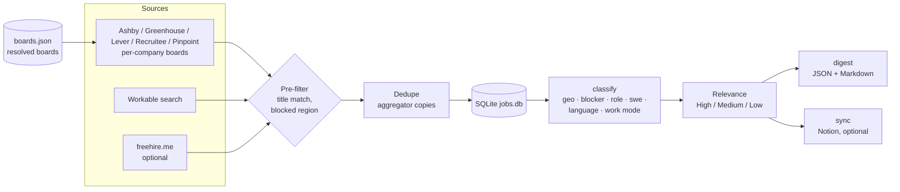

# job-radar

A self-hosted job radar for one person. It collects fresh postings from public ATS job-board APIs, filters them
through gates you configure in one YAML file, scores each posting against your profile, keeps everything in
SQLite and writes a daily digest as JSON and Markdown. Optionally it syncs the shortlist to a Notion database.
It runs from cron or a systemd timer.

- **Keyless public sources only:** Ashby, Greenhouse, Lever, Recruitee, Pinpoint, Workable search, and optionally
  freehire.me. No login, no cookies, no scraping of pages behind a sign-in.
- **Deterministic gates, no model calls:** every exclusion is a regex rule with its evidence stored next to the
  posting, so you can always see *why* something was dropped.
- **Standard library first:** Python 3.11+, one dependency (PyYAML).

Author: Vadim Smirnov. License: MIT.

## Quickstart

```bash
pip install -e .                                        # from a clone of this repository
cp config.example.yaml config.yaml                      # then edit companies, title_match and profile
job-radar collect --dry-run                             # fetch and list new postings, write nothing
job-radar collect                                       # fetch, store in jobs.db, run every gate
job-radar digest                                        # digest/YYYY-MM-DD.json and digest/YYYY-MM-DD.md
```

`python -m job_radar ...` works the same way. `job-radar stats` prints counts by gate, source, region and
relevance; `job-radar classify` re-runs every gate on stored postings after you change the config.

## How it works



1. **Board resolution.** Each company name in `companies` is turned into slug candidates (`Acme Labs` →
   `acme-labs`, `acmelabs`) and probed against every provider. Hits and misses are cached in `boards.json`, so
   the next run only fetches. A miss is retried only against providers it was not tried on; a 429 or 5xx is not
   an answer, so that provider stays untried. Give `provider` and `slug` to skip probing.
2. **Collection.** Boards are fetched in parallel under a global rate floor (and a slower one for Recruitee). One
   failing board, page or posting is logged and skipped; it never stops the run.
3. **Pre-filter.** Only postings whose title matches `gates.title_match` and whose location is not entirely in a
   blocked area are stored. Everything else is decided later by `classify`, so a config change applies to stored
   postings without fetching again.
4. **Dedupe.** An aggregator copy of a posting already fetched from its own board (same ATS id, same canonical
   URL, or same company + title within 30 days with no country conflict) becomes a sighting of the existing
   posting, never a second row.
5. **Classify.** Every gate runs; the first one that fires is stored in `excluded_reason`, with its evidence in
   its own column. Relevance is scored for every posting.
6. **Digest.** In-scope, fresh, Status `new`, Relevance in `digest.levels`; sorted by Relevance, score, then
   newest first.

## The gates

A posting is **in scope** when its title matches and no gate fires. Gates run in this order; the first one wins.

| Gate | `excluded_reason` | Fires when | Config |
|---|---|---|---|
| Region | `geo: <area>` | every listed place is in a blocked area | `gates.regions.blocked` |
| Region + relocation | `geo: <area>, no relocation` | every place is in a blocked or relocation-required area, at least one is relocation-required, and the posting offers neither relocation nor visa support | `gates.regions.relocation_required` |
| Work authorisation | `blocker: work authorization` / `blocker: no sponsorship` | the text states an existing right to work in a country, or no sponsorship | `gates.work_authorization` |
| Role family | `role: <family>` | the title (and for some families company or description) names a role you do not target | `gates.role_families`, `gates.custom_families` |
| Software engineer | `role: software engineer` | the requirements ask for a software-engineer background (scored, threshold 3) | `gates.software_engineer` |
| Language | `language: <names>` | a language outside `spoken` is required, or the description is written in it | `gates.languages` |
| Work mode | `work mode: <mode>` | the detected mode is not allowed | `gates.work_mode.allowed` |

Rules worth knowing:

- **Places.** A location is split on `;`, `|`, `/` and "or" into places; each resolves to `europe`, `americas`,
  `australia`, `oceania` (other than Australia), `asia_africa` (the Middle East counts as Asia) or `unknown`. An
  unresolved place ("Remote", "Worldwide") always keeps a posting in. "Portland, OR" stays one place.
  "Perth, Scotland" and "Melbourne, FL" are not Australian. Add place names with `gates.regions.extra_hints`.
- **Relocation and visa flags** are read from the description: `1` offered, `-1` explicitly not offered, `0` not
  mentioned. A negative statement always beats a positive one.
- **Role families** (switch any off by removing it from `gates.role_families`):
  `president`, `salesforce` (in the title, or Salesforce listed as a *required* qualification; a nice-to-have,
  an alternative tool, an integration or a customer mention keeps the posting), `recruiter`, `junior`, `ops`
  (sales ops and IC ops titles; an ops lead, manager or head is kept), `anonymous` (hidden employer),
  `engineer` (GTM / Growth / Marketing Engineer is kept), `sales` (quota roles and sales leadership, by title or
  a quota-dominated description), `gm` (Managing Director, Country Manager, Corporate Strategy, Chief of Staff),
  `d2c`, `retail`, `mobile_app`. A Head / Director / VP / Lead title with a growth, marketing or GTM word skips
  the title-only families unless it names the excluded role itself ("Lead Recruiter").
- **Language.** "Fluent German", "German (C1)", "Deutschkenntnisse" are requirements; "German is a plus",
  "English or German" and "the German market" are not.
- **Work mode** comes from explicit phrases only ("fully remote", "3 days a week in the office"); a city is not
  evidence. Several modes named as options means `unknown`. The ATS workplace field is the fallback.
- **Freshness.** A timestamp counts as is; a date without a time counts from 00:00 in `timezone`. A missing
  date is not fresh. Up to one hour in the future is clock skew; more is treated as bogus.
- **Signals** (`signals`) are tags matched in location + description. They rank, never filter.
  `Multi-location` is added for postings that list several places.

## Relevance

```yaml
profile:
  title:        {"head of growth|vp,? growth": 6, "growth": 2, "\\b(?:content|brand)\\b": -4}
  description:  {"experiment|a/b test": 1, "\\bb2b\\b|\\bsaas\\b": 1}
  thresholds:   {high: 8, medium: 4}
```

Each regex counts once. The sum maps to High (≥ `high`), Medium (≥ `medium`) or Low. The explanation is stored
in `relevance_why`, for example `High = 9: title 'head of growth|...' +6, title 'growth' +2, desc 'b2b' +1`.

## Config reference

All keys are optional except what you need for your sources; see [config.example.yaml](config.example.yaml)
for a complete, commented example. Relative paths resolve against the config file's folder.

| Key | Default | Meaning |
|---|---|---|
| `database` | `jobs.db` | SQLite file |
| `digest_dir` | `digest` | Where digests are written |
| `boards_cache` | `boards.json` | Resolved company boards |
| `timezone` | `UTC` | Midnight for date-only posted dates; digest file date |
| `user_agent` | `Mozilla/5.0 (compatible; job-radar/0.1)` | Sent with every request |
| `companies` | `[]` | Names, or `{name, provider, slug}` |
| `sources.ats` | all five providers, 6 workers, 0.12 s floor | Per-company boards |
| `sources.workable` | enabled, no queries | `queries` × `locations`, plus `remote_locations` with workplace=remote; `pages` of 20 |
| `sources.freehire` | disabled | `keywords`, `days`, `queries` (label + API params) |
| `gates.title_match` | `[]` (every title) | Regexes, case-insensitive |
| `gates.role_families` | every built-in family | List of names to exclude |
| `gates.custom_families` | `[]` | `{name, title_regex}` |
| `gates.work_authorization` | `true` | Right-to-work / no-sponsorship blocker |
| `gates.languages` | enabled, `spoken: [English]` | Required-language gate |
| `gates.software_engineer` | enabled, threshold from rules | `rules_file` to use your own phrase list |
| `gates.regions` | nothing blocked | `blocked`, `relocation_required`, `extra_hints` |
| `gates.work_mode.allowed` | all four modes | `remote`, `hybrid`, `office`, `unknown` |
| `gates.freshness_hours` | `24` | Window for the digest and Notion create |
| `signals` | `[]` | `{name, pattern}` tags |
| `profile` | empty | Relevance rules, see above |
| `digest` | High + Medium, 30, 2000 chars | `levels`, `limit`, `description_chars` |
| `notion` | disabled | See below |

## Notion sync (optional)

1. Create an internal integration in Notion, share an empty database with it, and copy the database id.
2. `export NOTION_TOKEN=...` and `export NOTION_DATABASE_ID=...` (or set `notion.database_id`), then
   `notion.enabled: true`.
3. `job-radar sync --dry-run` to see the plan, then `job-radar sync`. Missing properties are added on the first
   real run.

Sync creates a page only for a fresh posting with Relevance in `notion.create_levels`; existing pages are always
updated. Status set in Notion is never overwritten, and a Relevance you edited by hand is kept. Postings of one
company whose titles differ only by a trailing parenthetical and whose descriptions are near-identical become
one page ("Merged Job IDs", "Other locations"). Pages whose content did not change are skipped.

`job-radar archive --reason 'geo:' --dry-run` lists pages whose posting is now excluded with that reason prefix;
without `--dry-run` it writes a rollback log to `notion.log_dir` first, then moves the pages to the trash
(statuses in `notion.keep_statuses` are left alone). `job-radar archive --restore notion-logs/<log>.json` undoes
one run. Archived postings are never re-created by `sync`.

## Scheduling

cron, every morning at 07:00:

```cron
0 7 * * * cd /home/me/job-radar && .venv/bin/job-radar collect && .venv/bin/job-radar digest >> radar.log 2>&1
```

systemd (`~/.config/systemd/user/job-radar.service` and `job-radar.timer`):

```ini
[Unit]
Description=job-radar daily run

[Service]
Type=oneshot
WorkingDirectory=%h/job-radar
ExecStart=%h/job-radar/.venv/bin/job-radar collect
ExecStartPost=%h/job-radar/.venv/bin/job-radar digest
```

```ini
[Unit]
Description=job-radar daily timer

[Timer]
OnCalendar=*-*-* 07:00
Persistent=true

[Install]
WantedBy=timers.target
```

`systemctl --user enable --now job-radar.timer`

## Development

```bash
pip install -e . pytest
python -m pytest -q tests      # offline: every network call is mocked
```

CI (`.github/workflows/test.yml`) runs the tests on Python 3.11 and 3.13 and a gitleaks secret scan on every
push and pull request.

## Limits

- **Coverage is your company list plus Workable search.** A company whose board is on another ATS, or whose
  slug is not guessable from its name, needs an explicit `{name, provider, slug}` entry.
- **Pinpoint feeds carry no publish date**, so Pinpoint postings never count as fresh and never reach the
  digest; they are still stored and classified.
- **Rules are English-first.** The language and role gates know common German, French and Dutch phrasings;
  postings in other languages are mostly caught by the "written in another language" rule.
- **Regex gates make mistakes in both directions.** Every exclusion stores its evidence; check `stats` and the
  `*_evidence` columns before trusting a new rule.
- **Freshness depends on the source's date.** Greenhouse reports first publication; some boards re-publish old
  postings with a new date.
- No CV builder, no application automation, no sign-in to any job site.
